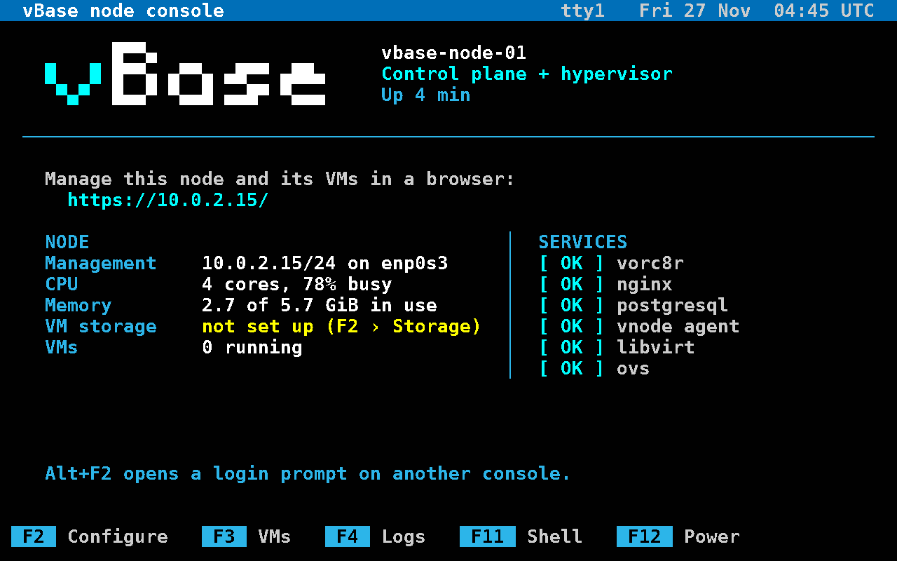

Each server shows the **vBase node console** on its screen: its address, its role, what it's using, and whether each service is running (vorc8r, nginx, postgresql, the vnode agent, libvirt, ovs).

| Key | Opens |
|---|---|
| **F2** | **Configure:** management network, storage (pool, Ceph, swap), date and time, restart management services, reset web admin password, join a control plane, reset the `vbase` password |
| **F3** | **Virtual machines** on this server: start, stop and open their consoles |
| **F4** | **Logs** of the control plane and the node agent |
| **F11** | A **shell** (login as `vbase`) |
| **F12** | **Shut down or restart** the server |

**Alt+F2** opens a login prompt on another screen.

:::caution
Anyone at the server's screen can use this menu. Keep servers somewhere only administrators can reach.
:::
