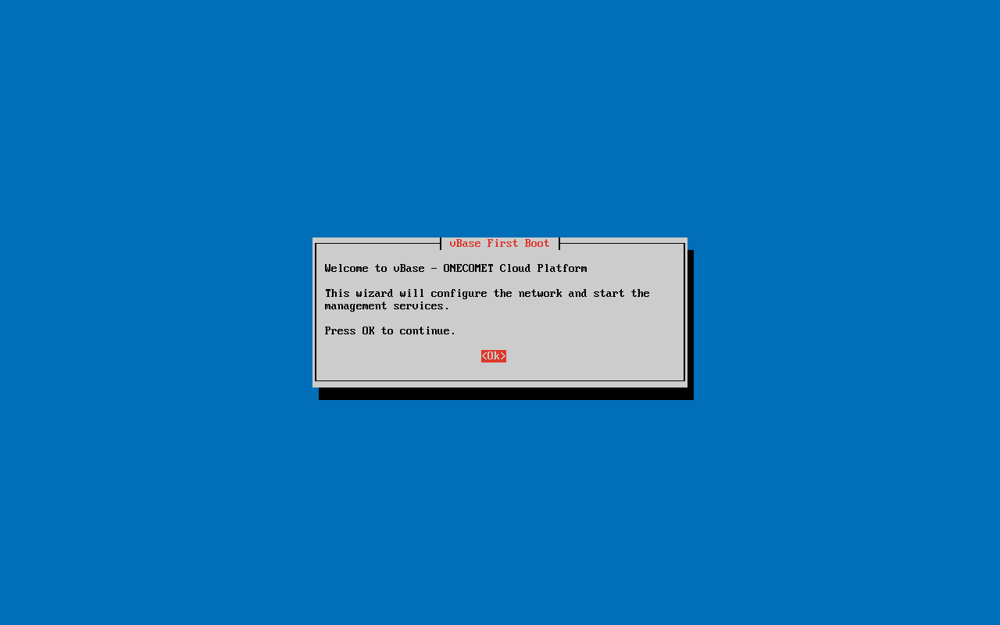
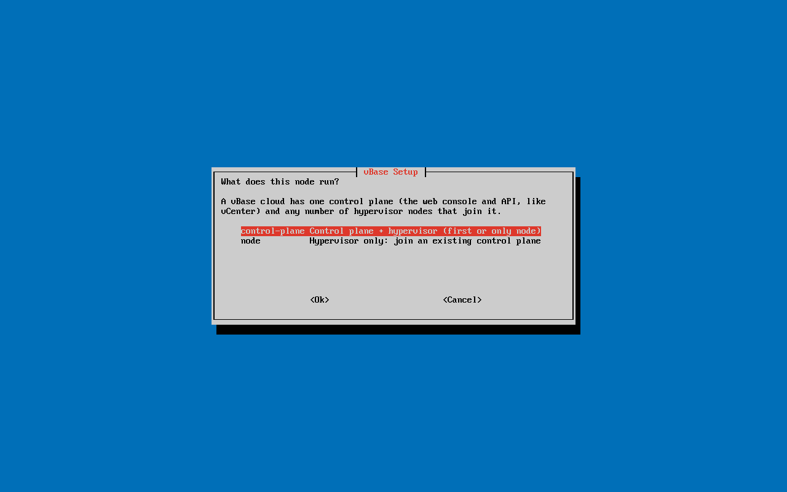
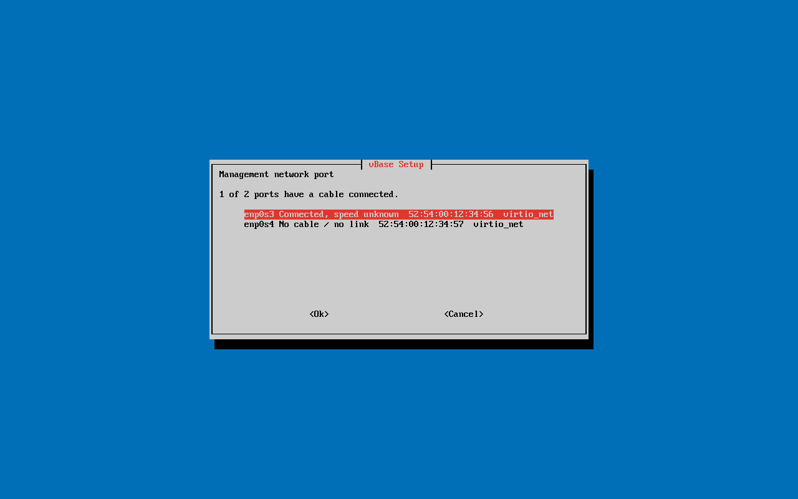
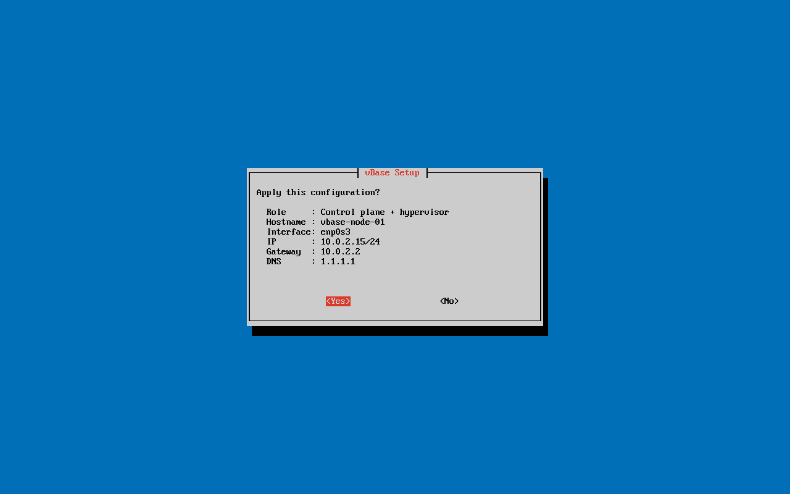
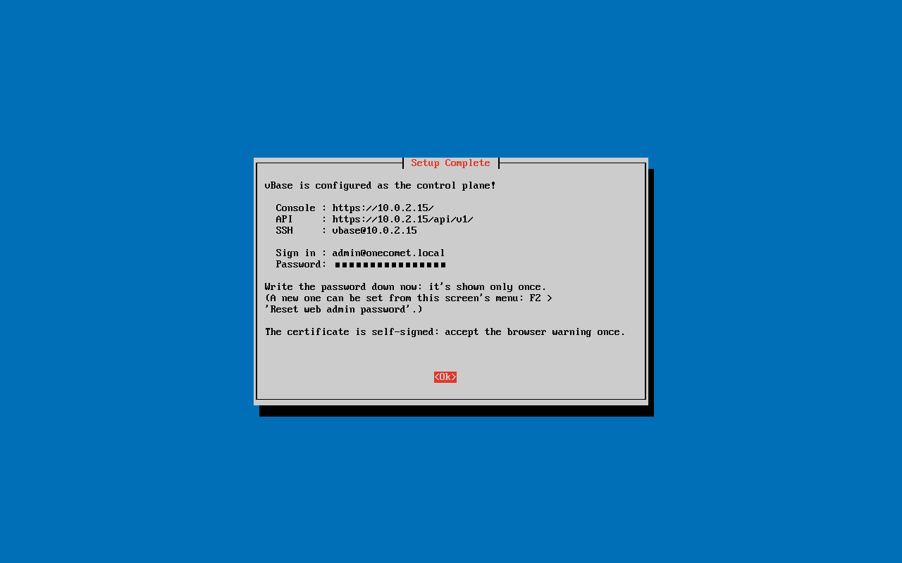
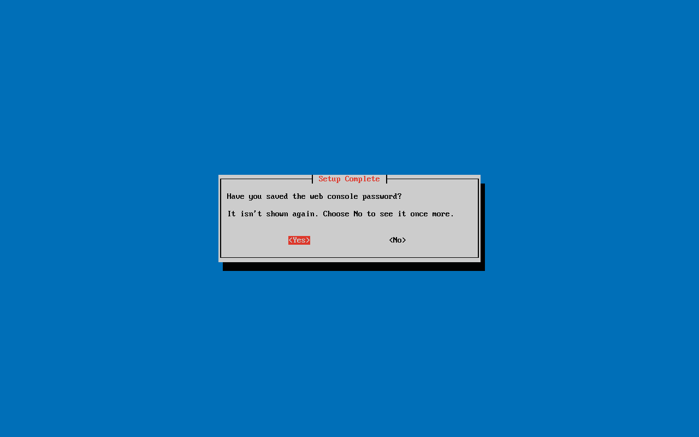

Plug the stick into the server and boot from it (on IBM System x, press **F12** and choose the USB device). The vBase boot menu starts **vBase** on its own after 5 seconds, then the setup wizard opens on the server's screen.



## The setup wizard

1. **Welcome.** Press Enter.
2. **Hostname** for this server, for example `vbase-node-01`.
3. **What does this node run?**
   - **control-plane**: the first (or only) server. It runs the web console and API, and VMs.
   - **node**: an extra hypervisor that joins an existing control plane.

   

4. **Management network port.** Each of the server's ports is listed with whether a cable is connected, its speed, MAC address and driver. Connected ports come first and the first is already chosen: check it's the one cabled to your management network.

   

5. **IP address** in CIDR form (`10.250.0.10/24`), then the **default gateway** and the **DNS server**.
6. **Password for the `vbase` account** (at least 8 characters, twice). It's the server's own login, for the console and SSH.
7. **Apply this configuration?** Check it and choose **Yes**, then press **OK** on "Applying configuration".

   

## Setup Complete

A control plane shows the addresses of the console, the API and SSH, and the **web console sign-in**: `admin@onecomet.local` and a password made for it.



:::caution[Write the password down]
It's shown only once and vBase doesn't keep a copy it can show you. Setup asks whether you've saved it; choose **No** to see it again.
:::



Lost it later? Set a new one from the server's screen: **F2 › Reset web admin password**.

Next: [sign in](/start/sign-in/).

## Extra nodes

A **node** needs a join string from the control plane: in the web console, **Hosts › Add host**. Paste it into the console menu's **Join a control plane**, or run:

```sh
sudo vnode join '<join string>'
```

The node then appears under **Hosts** in the web console.

## After a reboot

The server boots straight to the console menu: the wizard runs only once. See [the console menu](/operate/console-menu/).
